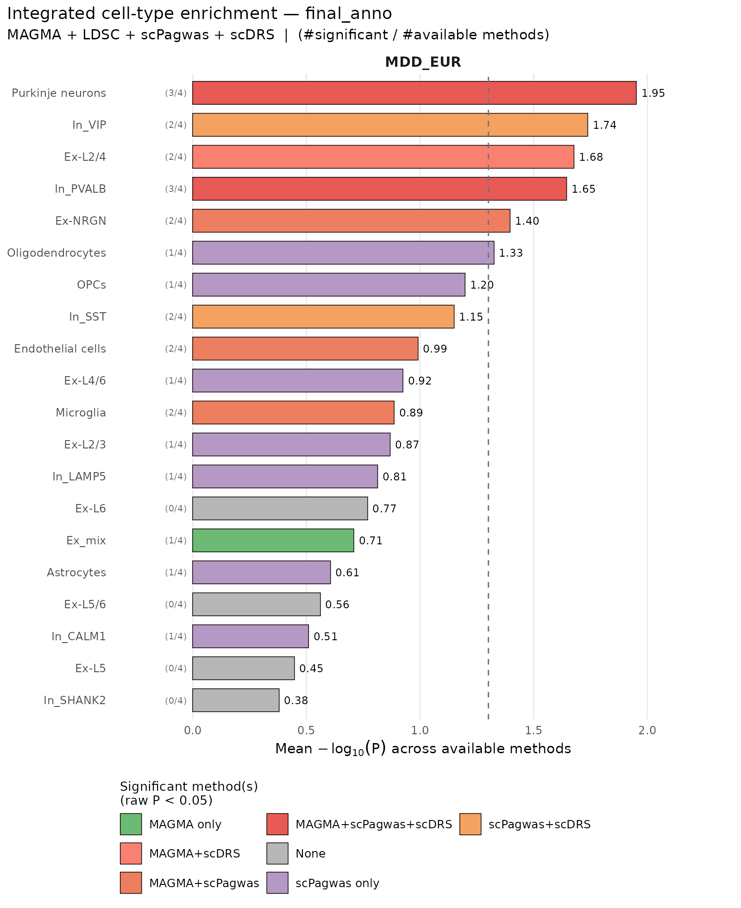
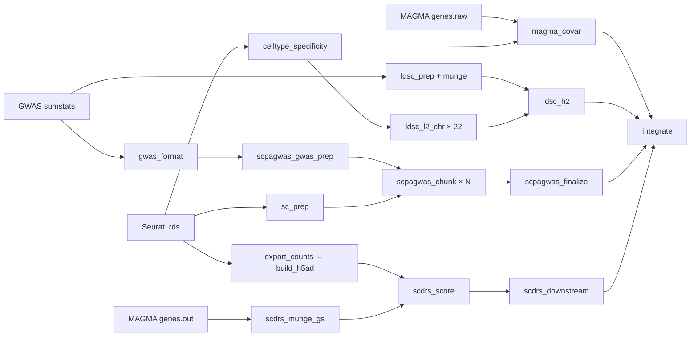

# scDepBrain-Fusion

**Map GWAS signals to cell types with four complementary methods (MAGMA, S-LDSC, scPagwas and scDRS) and combine them into one cell-type ranking, in a single Snakemake workflow.**

You provide:

| Input | What it is |
|---|---|
| GWAS summary statistics | any delimited text file (`.gz` ok) or an IEU OpenGWAS VCF |
| MAGMA gene analysis results | `.genes.out` and `.genes.raw` from the same `magma --gene-annot` run |
| Single-cell data | a Seurat object (`.rds`, v4 or v5) with raw counts and cell-type labels |

For every trait and every annotation level (e.g. major cell types and subtypes), the pipeline runs:

| Method | Signal used | Cell-type statistic |
|---|---|---|
| **MAGMA** gene-property analysis ([de Leeuw 2015](https://doi.org/10.1371/journal.pcbi.1004219)) | gene-level GWAS association | association with continuous cell-type specificity (`--gene-covar`) |
| **S-LDSC / LDSC-SEG** ([Finucane 2018](https://doi.org/10.1038/s41588-018-0081-4)) | SNP heritability | heritability enrichment around the top 10% specific genes (coefficient P) |
| **scPagwas** ([Ma 2023](https://doi.org/10.1016/j.xgen.2023.100383)) | pathway activity × GWAS, per cell | `Merge_celltype_p` of per-cell P values (plus cell-type bootstrap) |
| **scDRS** ([Zhang 2022](https://doi.org/10.1038/s41588-022-01167-z)) | disease gene set, per cell | group association (Monte Carlo P) |

It then **integrates** them. For each cell type the integration reports the mean −log10(P) across the available methods and which methods reach nominal significance, as a table and a bar chart:



scDepBrain-Fusion was built for the MDD × human-brain analysis of the scDepBrain project and works for any trait, tissue, or human single-cell dataset. MAGMA and LDSC can each be switched off if you don't have their reference files.

---

## Contents

1. [Workflow](#workflow)
2. [Installation](#installation)
3. [Demo](#demo)
4. [Running on your own data](#running-on-your-own-data)
5. [Outputs](#outputs)
6. [Reading the integrated result](#reading-the-integrated-result)
7. [Compute resources](#compute-resources)
8. [Method notes](#method-notes)
9. [Repository layout](#repository-layout)
10. [Citation](#citation) · [License](#license)

Detailed documentation lives in [`docs/`](docs/):
[inputs](docs/inputs.md) · [references (MAGMA / LDSC)](docs/references.md) · [parameters](docs/parameters.md) · [outputs](docs/outputs.md) · [methods](docs/methods.md) · [troubleshooting](docs/troubleshooting.md)

---

## Workflow



| Step | Script | What it does |
|---|---|---|
| `celltype_specificity` | `11_celltype_specificity.R` | Mean expression per cell type → specificity = expr / Σ expr (Bryois 2020). Writes the MAGMA covariate matrix (Entrez) and the LDSC gene sets (top 10% + all-expressed-gene control). |
| `magma_covar` | MAGMA | `magma --gene-results .genes.raw --gene-covar <specificity>` per trait × annotation level |
| `ldsc_prep`, `ldsc_munge` | `13_*.py`, `munge_sumstats.py` | GWAS → LDSC sumstats (HapMap3 SNPs) |
| `ldsc_l2_chr` | `12_ldsc_l2_chr.sh` | Annotations (gene ± 100 kb) and LD scores for **all** gene sets of one chromosome in one `ldsc --l2` run, split per gene set. Numerically identical to one run per gene set, but needs 22 jobs instead of hundreds. |
| `ldsc_h2`, `ldsc_collect` | `14_ldsc_h2.sh`, `15_*.py` | S-LDSC per cell type: baselineLD v2.2 + all_gene + cell type; one-sided coefficient P |
| `gwas_format` … `scpagwas_finalize` | `01`–`06` | scPagwas, with cells split into chunks for memory |
| `export_counts` … `scdrs_downstream` | `07`–`09`, scdrs CLI | scDRS on raw integer counts |
| `integrate` | `16_integrate_four_methods.R` | Four-method table and figure per annotation level |
| `summarize_trait` | `10_summarize_trait.py` | scPagwas × scDRS heatmap and per-cell agreement |

---

## Installation

Requirements: Linux or macOS, [conda](https://docs.conda.io/) or [mamba](https://mamba.readthedocs.io/), about 10 GB of disk for the environments, and the MAGMA / LDSC references ([docs/references.md](docs/references.md)).

```bash
git clone https://github.com/<your-account>/scDepBrain-Fusion.git
cd scDepBrain-Fusion

# 1. main environment (Snakemake, R / Seurat / scPagwas, Python / scDRS)
mamba env create -f envs/environment.yml
conda activate scdepbrain-fusion
Rscript envs/install_R_packages.R            # scPagwas (GitHub) + archived dependency SOAR

# 2. LDSC (separate Python 2 environment) and reference files
git clone https://github.com/bulik/ldsc.git references/ldsc
conda env create -f references/ldsc/environment.yml
#    + 1000G / baselineLD references under references/ldsc_ref/   (docs/references.md)

# 3. MAGMA executable + gene locations under references/magma/     (docs/references.md)
```

Tested with Python 3.10, Snakemake 7.32.4, scdrs 1.0.2, R 4.3.3, Seurat 5.4.0, scPagwas 2.0.0, MAGMA 1.10 and LDSC 1.0.1 (Python 2.7).

---

## Demo

The repository includes an 8,000-nucleus human brain dataset (31 MB) and MAGMA results for the PGC MDD 2025 EUR GWAS.

| File | Content |
|---|---|
| `example/data/example_brain_8k.rds` | Seurat object, 8,000 nuclei × 63,378 genes, raw counts. `anno`: 8 major cell types. `final_anno`: 20 subtypes, 400 nuclei each. |
| `example/data/magma/MDD_EUR_PGC2025.genes.out` / `.genes.raw` | MAGMA v1.10 gene analysis of PGC MDD 2025 EUR (±50 kb window, 1000G EUR LD reference) |
| `example/data/gwas/` | **you download the GWAS here** |

1. **GWAS.** Download the PGC MDD 2025 European-ancestry summary statistics without 23andMe from <https://pgc.unc.edu/for-researchers/download-results/> and save them as `example/data/gwas/pgc-mdd2025_no23andMe_eur_v3-49-24-11.tsv.gz`. The PGC terms of use apply.
2. **References.** Set up `references/` as described in [docs/references.md](docs/references.md), or set `methods: {ldsc: false}` / `{magma: false}` in the config to skip those methods.
3. **Run:**
   ```bash
   conda activate scdepbrain-fusion
   bash run_pipeline.sh config/config_example.yaml local -n     # dry run: lists 46 jobs
   bash run_pipeline.sh config/config_example.yaml local --cores 8   # ~80 min, ~25 GB RAM
   ```
4. **Look at** `results/demo/integrated/four_method_anno.png` and `four_method_final_anno.png`, and compare them with [`example/expected_output/`](example/expected_output/).

What the demo shows (`final_anno`, MDD 2025 EUR):

| | Demo result |
|---|---|
| Top integrated cell types | Purkinje neurons (MAGMA + scPagwas + scDRS), In_VIP, Ex-L2/4, In_PVALB (MAGMA + scPagwas + scDRS) |
| MAGMA (P < 0.05) | Purkinje neurons, Ex-L2/4, In_PVALB, Ex-NRGN, … |
| scDRS (P < 0.05) | Ex-L2/4, In_PVALB, In_VIP, Purkinje neurons, In_SST |
| LDSC | no cell type significant at this size (gene sets from 8,000 nuclei are noisy; heritability and munging checks pass) |
| scPagwas | **not interpretable at this size** (see below) |

Exact P values differ slightly between runs because scPagwas and scDRS draw random control gene sets.

> **The demo checks that the workflow runs.** scPagwas fits a regression for every cell and builds its trait-relevant gene set from the gene–gPAS correlation across cells. With a few thousand cells this signal is weak: in the demo it favours oligodendrocytes and OPCs, and its per-cell ranking does not match scDRS. In our tests scPagwas became stable from roughly 20,000 cells, and LDSC-SEG gains power with more cells per type. Use full-size datasets (≥ 20,000 cells) for inference.

---

## Running on your own data

1. **Prepare the inputs** ([docs/inputs.md](docs/inputs.md)).
   - **Seurat object**: raw integer counts in `counts`, and cell-type columns in `meta.data`.
   - **GWAS**: note the genome build. Effect allele, other allele and N are needed for LDSC.
   - **MAGMA**: run the gene analysis once, then use its `.genes.out` and `.genes.raw`.
2. **Write the config:**
   ```bash
   cp config/config_template.yaml config/my_config.yaml
   # edit every field marked  <-- EDIT ; one entry under `traits:` per GWAS
   ```
3. **Dry run**, which validates every path and column name:
   ```bash
   bash run_pipeline.sh config/my_config.yaml slurm -n
   ```
4. **Run:**
   ```bash
   export SBATCH_PARTITION=<partition> SBATCH_ACCOUNT=<account>   # SLURM only
   bash run_pipeline.sh config/my_config.yaml slurm                # or: local
   ```
   Re-running the same command resumes from the last finished step.

Per-trait options:
- `ldsc: false` for non-European / trans-ancestry GWAS;
- `n:` for a constant sample size;
- `scpagwas: {...}` to override scPagwas settings for that trait.

---

## Outputs

Under `<outdir>/` ([docs/outputs.md](docs/outputs.md)):

```
integrated/
  four_method_<group>.csv|png|pdf    per trait x cell type: MAGMA_P, LDSC_P, scPagwas_P, scDRS_P,
                                     n_sig, n_avail, significant_methods, mean_neglog10P
  four_method_all.csv                all annotation levels stacked
magma/<trait>_<group>.gsa.out        MAGMA gene-property results
ldsc/<trait>/ldsc_celltype_results.csv   S-LDSC coefficient, z, one-sided P, enrichment
scpagwas/<trait>/celltype_p_<group>.csv  scPagwas Merge_celltype_p (+ bootstrap, per-cell scores)
scdrs/downstream/<trait>.scdrs_group.<group>   scDRS association / heterogeneity
summary/<trait>/...                  scPagwas x scDRS heatmap, per-cell agreement
specificity/                         specificity matrices, LDSC gene sets, cell-type name map
logs/                                one log per step
```

---

## Reading the integrated result

- **Bar length**: mean −log10(P) across the methods available for that trait and cell type. The dashed line marks P = 0.05.
- **Colour**: which methods have raw P < 0.05 (`integration.alpha`). For example, "All four" (dark red) means MAGMA, LDSC, scPagwas and scDRS all agree. "scDRS only" means a single method.
- **(k/n)**: k of the n available methods are significant.

The methods answer slightly different questions:
- MAGMA and LDSC test whether the cell type's **specific genes** carry GWAS signal, at gene level and heritability level respectively.
- scPagwas and scDRS score **individual cells**.

Agreement across methods is the most robust evidence. The integration is a summary of nominal P values, not a formal meta-analysis; report the individual P values with multiple-testing correction as well.

Known caveats:
- scPagwas needs roughly ≥ 20,000 cells for stable results. With very large, highly powered meta-analysis GWAS it can give inflated, non-specific P values. Check `summary/<trait>/scPagwas_vs_scDRS_percell_corr.csv`: the per-cell scPagwas–scDRS correlation should be positive.
- scDRS P values have a floor of 1/(n_ctrl + 1).

---

## Compute resources

| Data size | Peak memory | Wall time |
|---|---|---|
| 8,000 cells (demo) | ~25 GB (8 parallel jobs; each < 15 GB) | ~80 min on 8 cores |
| ~300,000 cells | scPagwas chunks 200–400 GB, finalize ≤ 800 GB, scDRS ≤ 600 GB | 1–3 days on a cluster |

MAGMA and LDSC are light: LDSC needs about 8 GB per chromosome job and runs one regression per cell type. Set per-rule memory and time under `resources:` ([docs/parameters.md](docs/parameters.md#scaling-resources)).

---

## Method notes

- **Default scPagwas settings** reproduce our lab's original workflow: `block_annotation_hg37`, `maf_filter = 0.1`, `marg = 10 kb`, KEGG pathways, `scGet_PCC`, top / bottom 500 genes, `Get_CorrectBg_p(iters = 100, n_topgenes = 1000)`.
- **Specificity** (MAGMA and LDSC) follows Bryois et al. 2020: mean expression per cell type divided by its sum over cell types. It is computed once per annotation level from the Seurat object.
- **scDRS gets true raw counts** (checked); `SeuratDisk::Convert` is not used.
- **Genome build.** Use GRCh37 references throughout for GRCh37 GWAS: MAGMA gene.loc, LDSC panel, `block_annotation_hg37`.

Full description: [docs/methods.md](docs/methods.md).

---

## Repository layout

```
Snakefile                    workflow definition
run_pipeline.sh              launcher (local | slurm)
config/                      config_template.yaml (annotated), config_example.yaml (demo)
profiles/local, profiles/slurm   Snakemake execution profiles
scripts/                     one script per step (R / Python / bash)
envs/                        conda environment + R install script
references/                  MAGMA / LDSC files (not tracked; see docs/references.md)
example/data/                demo Seurat object, MAGMA results, gwas/ download folder
example/expected_output/     reference demo outputs
example/build/               how the demo object was made
docs/                        detailed documentation
```

---

## Citation

If you use this pipeline, please cite the methods it wraps:

- de Leeuw CA, *et al.* MAGMA: generalized gene-set analysis of GWAS data. *PLoS Comput Biol* 11, e1004219 (2015).
- Finucane HK, *et al.* Heritability enrichment of specifically expressed genes identifies disease-relevant tissues and cell types. *Nat Genet* 50, 621–629 (2018).
- Bryois J, *et al.* Genetic identification of cell types underlying brain complex traits yields insights into the etiology of Parkinson's disease. *Nat Genet* 52, 482–493 (2020).
- Ma Y, *et al.* Polygenic regression uncovers trait-relevant cellular contexts through pathway activation transformation of single-cell RNA sequencing data. *Cell Genomics* 3, 100383 (2023).
- Zhang MJ, *et al.* Polygenic enrichment distinguishes disease associations of individual cells in single-cell RNA-seq data. *Nat Genet* 54, 1572–1580 (2022).
- Mölder F, *et al.* Sustainable data analysis with Snakemake. *F1000Research* 10, 33 (2021).

For the demo GWAS: Adams MJ, *et al.* (Major Depressive Disorder Working Group of the Psychiatric Genomics Consortium). *Cell* (2025).

## License

[MIT](LICENSE). Third-party tools (MAGMA, LDSC, scPagwas, scDRS) and the GWAS / reference data keep their own licenses and terms of use.
